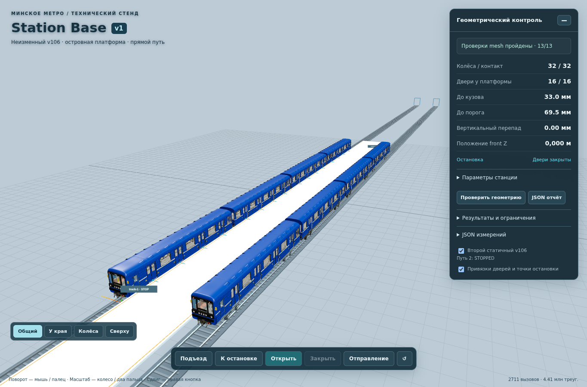
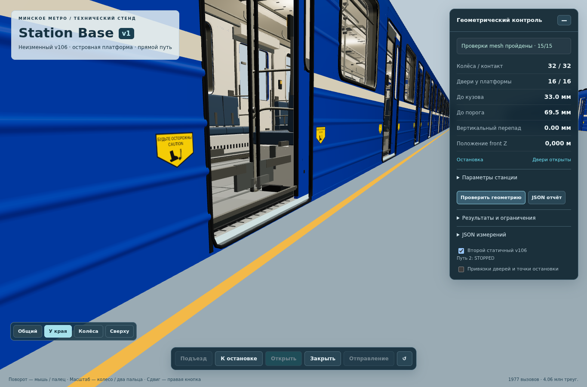
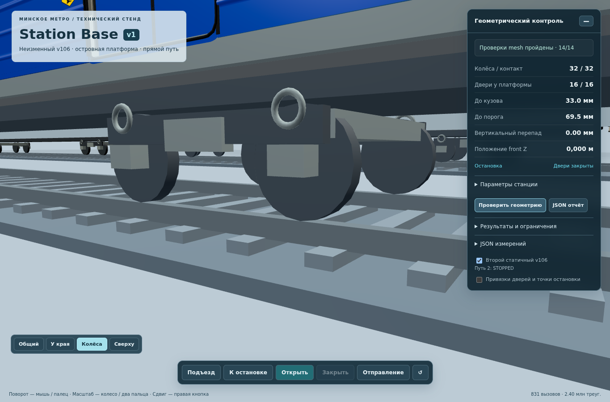

# Station Base v1 — итог ТЗ №2 и дополнения
**30 октября 2026, Минск. Статус: разработка технической версии завершена, ожидается визуальная и техническая приёмка владельцем.**

- Ветка: [feature/station-base-v1](https://github.com/SSKUZ/Minskmetrogame/tree/feature/station-base-v1).
- [Открыть технический 3D-просмотрщик](https://raw.githack.com/SSKUZ/Minskmetrogame/feature/station-base-v1/station-base.html). При первом входе CDN может показать кнопку **Open the page**.
- Проверенный код: `b5cd664c1f7ca9c4f86a15b96d6cf4803acbb1f5`.
- Checkpoint доказательств: [b96e52d800](https://github.com/SSKUZ/Minskmetrogame/commit/b96e52d80092db20d1b8a9ebde7dbd9e35217397).
- [Успешный CI run 41041282769](https://github.com/SSKUZ/Minskmetrogame/actions/runs/41041282769): все шаги завершились успешно.
- [Модули, параметры, инструкции и ограничения](README.md); [история промежуточных checkpoint и исправлений](PROGRESS.md).

## Реализовано

Два параллельных пути и островная платформа; на каждом пути настоящий четырёхвагонный v106. Для первого работают демонстрационные подъезд, остановка, открытие/закрытие дверей и отправление. Второй стоит статично с противоположной стороны острова; его видимость отключается отдельным переключателем. Камера свободная, предусмотрены четыре ракурса.

Оси путей: X=0 и X=−10,740 м. Второй путь вычисляется: `primaryTrackX − platformWidth − 2*edgeOffset`, здесь ширина острова 8 м, edgeOffset 1,370 м. Техническая длина острова 105 м не объявляется реальным размером Малиновки.

У путей независимые StopAnchor, по 16 обслуживаемых дверей, отдельные waiting/boarding/alighting zones, по два TunnelPort. Поддержан пересчёт обоих направлений с правильной мировой стороной открытия. Контракт второго пути содержит EMPTY/APPROACHING/STOPPED/BOARDING/DEPARTING, без AI, расписания и движения встречного поезда.

Основные модули: StationDefinition, TrainCompatibilityProfile, TrackModule, PlatformModule, TrainStopModule, TunnelConnector, CollisionModule, PassengerStationContract, DecorationInterface, Validation. Дополнительно выделены GeometryValidation, V106Adapter, DemoMotion, TrackOccupancyContract и WebSceneAdapter.

Геометрические recipes и параметры, нейтральные описания материалов и коллизии отделены от Three.js-представления. Экспорт JSON включает profile, primitive descriptors, материалы, привязки и результаты измерений. Исходники технических ресурсов редактируемые; законченный GLB/FBX-пакет и импорт в Roblox не создавались.

## Результаты геометрической проверки

| Проверка | Результат |
|---|---|
| Все колёса | 32 контакта на каждом составе, всего 64 в паре |
| Профиль рельсов | Четыре реальные рельсовые mesh; верх Y=0; центры каждой пары ±0,900 от оси |
| Размещение v106 | Только root transform: Y=+0,220, продольный offset ±9,603 и yaw 0/π |
| Верх платформы / порога | Y=1,1805; номинальный перепад 0 |
| До кузова в проверенной полосе высот | Около 33 мм на обеих сторонах |
| До утопленного порога | Около 69,5 мм |
| Обслуживаемые двери | По 16 на путь, независимые ID и остановки |
| Пересечение поезда с плитой | Не обнаружено; измерены реальные треугольники и реальные грани плиты |
| Два состава между собой | Не пересекаются; консервативный разрыв полных AABB по X около 7,647 м |
| Оба направления | Четыре сочетания «путь × направление», проверены реальные mesh и все door states |
| Контроль исходной геометрии | SHA256 BufferGeometry до/после совпадает: `c03fda5dd200a997d51d6dc4e0f0699ca3f736657e1cd904c5f5f3fb5c3560c1` |
| Защищённые игровые файлы | По сравнению с базовым b0c901... исходники preview/v106, js/train, js/main и пассажиров не изменялись |
| Слияния | Не выполнялись |

**13** unit/contract tests пройдены. CPU-аудит: **50** положительных сценариев и **6** отрицательных сценариев с намеренным сдвигом поезда, подъёмом рельса и сдвигом реальной плиты. Все ошибки обнаружены; ожидаемые геометрические значения для их сокрытия не менялись.

[Полный CPU-отчёт](../../test-results/station-base/geometry.json) содержит все результаты. Node CI использует `three@0.160.1`, совпадающий с указанной зависимостью viewer; GPU-рендер проверен отдельно в Chromium.

Область подтверждённого прохождения: прямая, горизонтальная опора, фиксированный поперечный профиль, без крена/уклона. Проверка по всей длине состава даёт поперечный экстремум полосы высот; чистое движение вдоль Z его не увеличивает. Для произвольных кривых такой вывод не заявляется.

## Браузерная приёмка

| Сценарий | Результат |
|---|---|
| two trains stopped | Пройдено |
| served doors open, departure blocked | Пройдено |
| second train hidden | Пройдено |
| arrival stopped at reference | Пройдено |
| departure | Пройдено |
| opposite direction on both tracks | Пройдено |

Закрытие дверей проверено перед скрытием второго состава и отправлением. При открытых/движущихся дверях отправление блокируется. После подъезда проверена точная отметка frontZ=0. Обратная конфигурация первого пути даёт frontZ=79,224 и противоположное направление второго поезда. Ошибок страницы и ошибок console в итоговом прогоне: **0**.

Все **6** снимков получены: общий вид двух поездов, край платформы, открытые двери, контакт колеса/рельса, вид сверху в обратной конфигурации, viewport 412×915. Для doors-open, wheel-rail-contact и two-trains-top-reversed потребовалась одна повторная попытка захвата. Это сохранено в `captureWarnings`; `capturesComplete=true`. Ни один итоговый дополнительный кадр не пропущен.

[Подробный browser.json](../../test-results/station-base/browser.json). Первые неуспешные runs сохранены в истории: они выявили нестабильность screenshot API и зависимость времени демонстрации от ограниченного dt. Исправлены сохранение framebuffer/диагностики и монотонные часы демонстрации; основная TrainPhysics не изменялась. Геометрические assertions и 45-секундный предел достижения остановки не ослаблялись.

## Скриншоты

### Два состава у островной платформы

### Открытая обслуживаемая дверь

### Контакт колеса и рельса

Дополнительные кадры: [край платформы](../../test-results/station-base/platform-gap.png), [сверху, обратное направление](../../test-results/station-base/two-trains-top-reversed.png), [viewport телефона](../../test-results/station-base/mobile.png).

## Ограничения и остановка работы

1. Это техническая совместимость с текущим v106, не исполнительный разрез настоящей Малиновки и не подтверждение реальной колеи.
2. Работает только прямой горизонтальный двухпутный участок с одним островом. Формат содержит tracks[], platforms[], stops[] и platformId; другие runtime topology явно отклоняются до отдельной реализации.
3. Пассажиры не интегрированы. Данные двух сторон подготовлены; сиденья, внутрисалонные очереди, поручни, exit graph и потребитель второй стороны потребуют отдельного задания.
4. Второй поезд статичный. Движение, AI, расписание и пассажирообмен не выполнялись.
5. Геометрия и временные профили движения основной игры не изменены; новая страница её не заменяет.
6. Два v106 дают около 4,4 млн видимых треугольников в общем ракурсе. Частота рендера ограничена сверху 20 кадрами/с; это не обещание фактических 20 FPS. Физические Honor Pad X9/Android устройства не проверены. Viewport телефона не равен проверке реального устройства; техническую панель можно свернуть кнопкой «−».
7. Roblox-плейс, импортная приёмка и перенос логики не создавались. Реалистичная архитектура станции, тоннели, депо и путейцы не моделировались.

**Работа над ТЗ №2 останавливается после передачи этого checkpoint. Дальнейшие изменения — после визуальной и технической приёмки владельцем.**
