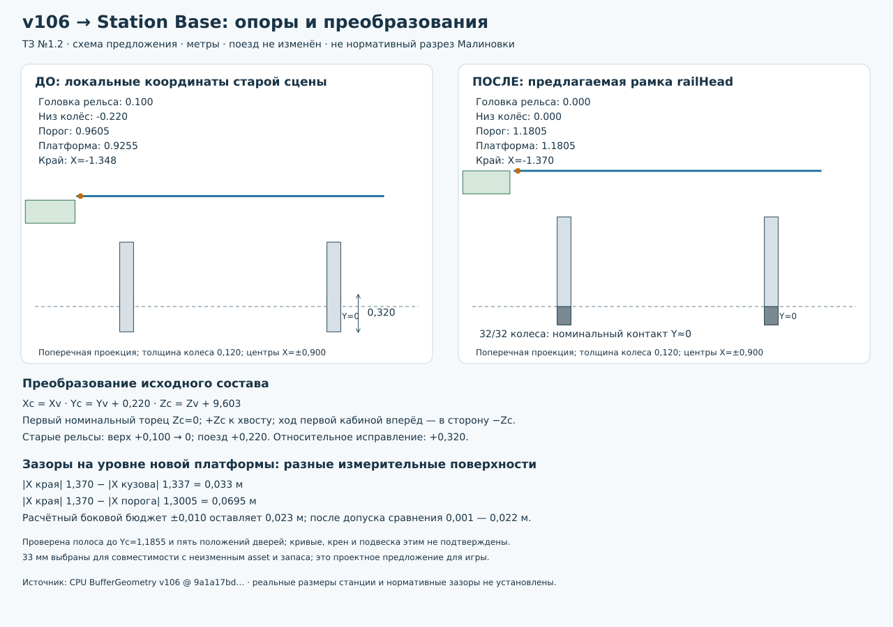

# Station Base: окончательное техническое предложение №1.2

**Проект «Минское метро» · 30 октября 2026, Минск.** Ветка `research/malinovka-station-base-20261030`. Основа — `909def5c664413a57d2dbf3b28030a561ef12bbb`. Статус: **проект готов для утверждения; реализация не начата**.

## 1. Решение, предлагаемое к утверждению

Принять головку рельса за Y=0 и отдельный версионируемый профиль **v106-compat-box-1**. Исходную геометрию v106 сохранить. Его размещение относительно этой опоры задавать жёстким переносом `(0; +0,220; +9,603)`; nominal front reference первой кабины окажется на Z=0, положительная Z направлена к хвосту.

Для первой прямой горизонтальной технической версии предлагается платформа на **Y=1,1805 м**, на уровне основного пола и порогов, с краем **X=−1,370 м** у обслуживаемой стороны. Получается **33 мм до измеренной внешней геометрии на высоте края и ниже** и **69,5 мм до наружной грани утопленного порога**. Прежние 20–30 мм не используются как автоматически правильный норматив.

Это инженерный компромисс для неизменного игрового asset: 33 мм оставляют 23 мм после пробного бокового смещения 10 мм, либо 22 мм с дополнительным допуском сравнения 1 мм. Порог утоплен относительно внешнего габарита на 36,5 мм; уменьшить расстояние до порога без уменьшения body clearance невозможно. Изменение порога/вагона не предлагается скрыто включать в Station Base.

Числовой профиль решает геометрическую совместимость **прямого контрольного участка**. Он не объявляется исполнительным разрезом Малиновки или нормативным профилем настоящего метро. Неизвестные размеры настоящей станции остаются отдельно от параметров технического ядра. Начать разработку универсальных модулей после утверждения этого предложения можно без выдачи гипотез 105×10 м за достоверные размеры станции.

## 2. Что дополнительно проверено

Повторно исполнены исходные построители v106, factory и batching на CPU Three.js r160. Геометрия не заменялась примитивными макетами. Измерены матрицы и вершины всего корня состава, включая межвагонные соединения. Расширен исследовательский скрипт из №1.1; он создаёт только временную сцену для измерения существующих ресурсов, а не Station Base.

Проверки №1.2:

1. **32/32 колеса:** низ после предложенного переноса отличается от Y=0 менее чем на 1 мкм; центры поперёк совпадают с рельсами X=±0,900 менее чем на 1 мкм. Это численная точность mesh, не точность реального обмера.
2. Реальные треугольники отсечены двумя горизонтальными плоскостями, чтобы получить габарит **полосы высот**, а не только одного сечения или AABB каждого mesh. Для плиты толщиной 0,200 м, полного борта от railHead до края, расширенной полосы с ±5 мм и пяти положений дверей (0/25/50/75/100%) максимальный abs(X)=**1,337000012 м**.
3. При X края=−1,370 м во всех пяти положениях остаток после условного бокового бюджета 10 мм — **22,999988 мм**. Учёт Y-бюджета выполнен расширением полосы до локальных Y=−0,225…0,9655. Пробные X/Y отклонения здесь — проверка collision reserve, не симуляция подвески и не утверждение контакта колёс при вертикальном отрыве.
4. Проверены все **32 проёма** обеих сторон: между продольными AABB открытых створок около **1,203 м**. Номинальные 1,380 м не равны фактическому промежутку открытого положения. Это консервативная проекция створок, не окончательный обмер свободного прохода с косяками.
5. Извлечены реальные **168 подушек сидений** и исходные кривые/оси поручней, потеря которых после batching мешала бы простому обходу TubeGeometry. Данные преобразованы с учётом заднего головного вагона.
6. Для 16 обслуживаемых дверей вычислены канонические coordinates и точная рамка будущего PassengerLayout. Выявлены конкретные будущие изменения потребителей, которые нельзя решить одной подстановкой дверных координат.

В номинальной позе полный корень состава имеет X=±1,5465; Y≈0…3,916589; Z≈−0,452000…79,676000. Длина **80,128001 м** включает выступающие детали. Объёмные проверки полосы не используют ложное допущение, что весь поезд имеет ширину 2,670 м.

**Безопасное прохождение доказано в ограниченном геометрическом смысле:** для прямой, уровня, фиксированных поперечных осей и чистого перемещения вдоль Z полная поперечная полоса неизменна, поэтому перенос не может создать новое пересечение с вертикальным бортом X≤−1,370 при соответствующей высотной маске. Пять door states дополнительно измерены; исходная door animation меняет только продольное положение створок, поэтому их поперечный диапазон от фазы не зависит. Колонны, стены, подвеска, поворот, крен, кривая, уклон и движущиеся люди требуют отдельных объёмов/приёмки. Утверждать универсальную безопасность произвольного маршрута по этому результату нельзя.

## 3. Единая система координат

### 3.1. Каноническая рамка поезда и пути

Правая система, метры: X поперёк, Y вверх, +Z от первой кабины к хвосту. При движении первой кабиной вперёд скорость направлена к −Z. На прямом контрольном пути railHead Y=0; точки на оси пути X=0. Отдельные station/world transforms размещают эту рамку на карте.

Для точки исходного viewer `v=(xv,yv,zv)`:

```text
xc = xv
yc = yv + 0.220
zc = zv + 9.603
v_world = M_station * T(0,0,stopS) * Ry(heading) * T(0,0.220,9.603) * M_car * v_car
```

`M_car` — исходная матрица сборки: центр первого вагона Z=0, затем 20,006/40,012/60,018; у последнего Ry(π). Если на входе уже координаты всего viewer, M_car повторно не применять. Обратное преобразование выполняется обратными матрицами в обратном порядке; нельзя просто менять знак Z у задней кабины, забывая X.

Канонические центры вагонов: **9,603 / 29,609 / 49,615 / 69,621 м**. Номинальный первый передний торец Z=0, дальний номинальный торец Z=79,224. Физическое оборудование выходит за эти плоскости на 0,452 м с каждого конца.

Для движения задней кабиной вперёд новый front reference — прежняя номинальная дальняя плоскость 79,224. Преобразование уже канонической точки: `T(stopS) * Ry(π) * Tz(−79.224) * v_c`. Оно не равняется повороту вокруг первого торца: такой поворот перенёс бы состав не туда. Выбор обслуживаемой стороны выполняется по transformed normal; у заднего 717 локальная сторона меняется.

### 3.2. Остальные сущности

| Сущность | Опора и рамка |
|---|---|
| Рельсы | Две нити в track frame; верх Y=0; профиль, центр каждой нити и рабочие грани отдельны |
| Платформа | Верх Y=1,1805 в выбранном совместимом профиле; footprints/usable extents принадлежат station frame |
| StopAnchor | Номинальная передняя плоскость активной кабины, trackId, direction, side, stopS и tolerance |
| Пассажиры в поезде | Каноническая S от активного reference либо явная матрица выбранного car; нельзя смешивать оба представления |
| Пассажиры платформы | Station frame; переход между train/station сохраняет world position |
| Тоннельные порты | Track frame, касательная, railHead, положения обеих нитей, profileId; разные торцы имеют противоположные outward normals |
| Архитектура | Station frame; отдельные mounting anchors и высотные запретные объёмы |

Для первой реализации Station Base допускает только прямой горизонтальный runtime. Формат данных предусматривает остальные topology/frame, но unsupported mode должен явно отклоняться. Это не повод возвращать общие ресурсы в одноразовую сцену Three.js.

## 4. Рельсы: исправление без изменения поезда

Исходный низ колеса −0,220, исходная головка +0,100: совпадение не достигнуто на 0,320 м. Возможны две математически эквивалентные привязки:

| Представление | Train root Y | Rail top Y | Threshold top Y | Что означает |
|---|---:|---:|---:|---|
| Старое | 0 | +0,100 | 0,9605 | Пересечение 0,320 |
| Исправление при сохранении старого рельсового datum | +0,320 | +0,100 | 1,2805 | Контакт есть, но старая платформа даёт ступень 355 мм |
| **Рекомендуемое railHead=0** | **+0,220** | **0** | **1,1805** | Рельсы перенесены относительно старых на −0,100; единая система опор |

Для нового контрольного профиля: X центров рельсов ±0,900; прямоугольная головка 0,120×0,160; центр Y=−0,080. Колесо шириной 0,120 занимает X=±0,900 ±0,060. Проекции номинально перекрываются полностью; все 16 продольных осей попадают на непрерывные нити.

**1,800 м — расстояние между центрами нитей/колёс этого asset, не утверждённая реальная колея.** Между внутренними гранями коробок 1,680 м, но эти коробки не описывают настоящий рабочий профиль колеса/рельса. При неизменных колёсах нельзя самостоятельно объявить реальный рельсовый профиль, сдвинув нити поперёк. Для первой версии принять явно названный игровой compatibility profile; соответствие настоящей инфраструктуре останется отдельным решением после первичного разреза.

Вместо разрозненных рельсов станции и портала ±1,150 будущий новый модуль использует один profileId. На каждом TunnelPort при совмещении должны совпасть центры обеих нитей и отметка railHead с допуском 1 мм, касательные — с допуском 0,1° (предлагаемые критерии). Сравниваются мировые точки нитей, а не только строка profileId. Outward normals противоположны; отражение порядка left/right при стыке не должно переставлять физические рельсы. Геометрия тоннеля сейчас не создаётся.



## 5. Платформа: сравнение вариантов

При новом datum неизменный порог имеет Y=1,1805. Поэтому технически честный выбор — поднять будущую платформу к этому основному уровню, а не менять пороги. Мелкие накладные швы и отделка пола могут выступать над основной плоскостью; равенство означает уровень основной ходовой поверхности, не отсутствие всех микровыступов.

| Вариант | Платформа | Край | До внешнего габарита | До порога | Оценка |
|---|---:|---:|---:|---:|---|
| Сохранить нынешнюю относительную геометрию платформы, нормализовав старый рельс | 0,8255 | −1,348 | Не решает высоту | 47,5 мм | После исправления колёс ступень 355 мм; отклонить |
| Сохранить старый перепад 35 мм после исправления контакта | 1,1455 | −1,348 | На прежнем сечении около 24 мм | 47,5 мм | Ступень остаётся без технической необходимости |
| Уровень порога, прежний край | 1,1805 | −1,348 | 11 мм | 47,5 мм | Недостаточный запас при пробном X=10 мм; отклонить |
| Уровень порога, край из №1.1 | 1,1805 | −1,362 | 25 мм | 61,5 мм | После X-бюджета и epsilon остаётся 14 мм; слабее выбранного |
| **Рекомендуемый** | **1,1805** | **−1,370** | **33 мм** | **69,5 мм** | После того же бюджета/epsilon 22 мм; поезд неизменён |

В строке с сохранением 35 мм дано прежнее сечение как ориентир; объёмная приёмка в №1.2 выполнена для рекомендуемого нового уровня. Зазор 69,5 мм до порога — геометрический результат его утопленного положения. Это не доказанный норматив доступности и не разрешение скрыто добавить подвижной мостик. Если владелец потребует меньший sill gap одновременно с большим body gap, задача несовместима с неизменным поперечным профилем: потребуется отдельное изменение asset или иной согласованный механизм.

Выбранные 33 мм и пробные бюджеты являются **предложением**, а не измеренной динамикой и не нормативом. Пока нет обоснованного roll/yaw envelope, минимально разрешённая область применения — прямая без крена/уклона. После появления динамики clearance рассчитывается заново.

## 6. Параметры, пассажиры и последовательность реализации

Полная таблица А/Б/В: [GEOMETRY-PARAMETERS-TZ1.2.md](GEOMETRY-PARAMETERS-TZ1.2.md). В ней реальные размеры Малиновки отделены от игровых mesh и от предлагаемых решений. У универсального каркаса нет навечно заданной ширины и длины.

[PASSENGER-ADAPTER-TZ1.2.md](PASSENGER-ADAPTER-TZ1.2.md) фиксирует все 16 обслуживаемых дверей, рамки перехода, сиденья, стоячие кандидаты, поручни, колонны и выходы. [V106-COMPATIBILITY-TZ1.2.json](V106-COMPATIBILITY-TZ1.2.json) содержит реальные anchors и измеренную геометрию поручней; проектные поля помечены отдельно. Это исследовательская спецификация, не готовый к запуску PassengerLayout.

Критические ограничения интеграции теперь конкретны:

- Фиксированная внутрисалонная очередь `aisleX±0,71` может пересекать подушки v106. Одной заменой bounds это не исправляется.
- Логика занятости/соседства по расстоянию 0,58 м не соответствует шагу сидений 0,435–0,475 м. Нужны seat ID и реальная adjacency, иначе все 168 физических подушек не станут используемыми местами.
- После batching нельзя полагаться на обход TubeGeometry; осевые curves из sidecar должны подаваться как gripAnchors, длинные цилиндры 714 учитываются отдельно.
- Ширину прохода и swept volume створок нельзя описывать одним legacy halfWidth. Нужны независимые данные и условие закрытия.
- DeparturePath содержит фиксированные смещения вместо exit graph; реальные лестницы требуют расширения потребителя. Ориентация +X и произвольная world matrix также пока не поддерживаются текущим потребителем.

Включать эти изменения в создание одного Station Base без согласования нельзя. Без изменения поезда и пассажиров можно реализовать новые независимые Coordinate/Track/Platform/Stop/Collision/Decoration modules, TunnelPort contract и пассажирские **данные/валидатор**. Полноценный обмен работающих пассажиров — отдельная интеграция.

[IMPLEMENTATION-PLAN-TZ1.2.md](IMPLEMENTATION-PLAN-TZ1.2.md) содержит порядок модулей, результаты и критерии приёмки. Геометрия, материалы, коллизии, manifest и runtime отделены. Редактируемые общие DCC-источники, экспортируемые модули и textures предназначены для браузера и будущего Roblox; scale/axis adapter и Luau не смешиваются с геометрией. Place/перенос в Roblox не выполняется.

## 7. Проверяемые артефакты и источники

| Артефакт | Назначение |
|---|---|
| RESEARCH-TZ1.2-20261030.md | Окончательное предложение, конфликты и условия |
| GEOMETRY-PARAMETERS-TZ1.2.md | Таблицы А/Б/В |
| COORDINATES-TZ1.2.svg | Точная числовая схема до/после |
| V106-COMPATIBILITY-TZ1.2.json | Измеренные anchors + отдельно предложения |
| PASSENGER-ADAPTER-TZ1.2.md | Контракт будущего подключения и требуемые изменения |
| IMPLEMENTATION-PLAN-TZ1.2.md | Модули и этапы реализации |
| tools/audit-v106-standard-cpu.mjs | Воспроизводимый измеритель исходной геометрии |
| measurements/v106-standard-9a1a17b.json | Все 32 контакта, 32 ширины, 16 обслуживаемых anchors, полосы/проверки/хеши |

Поезд и сцена: SHA [9a1a17bd68039a47e5ea0742bccd285dc100bf16](https://github.com/SSKUZ/Minskmetrogame/tree/9a1a17bd68039a47e5ea0742bccd285dc100bf16). Измерены preview/wagon.html, train-factory.js, train-components.js, train-batching.js и строки размещения js/main.js. Пассажиры: SHA [78fd59ae0d39a292b2f7dc9e43577e6d7e7b4fc6](https://github.com/SSKUZ/Minskmetrogame/tree/78fd59ae0d39a292b2f7dc9e43577e6d7e7b4fc6), в частности PassengerLayout, System, BoardingController, NavigationZones, Places, Seating и RailGrip. Обе рабочие головы перепроверены на момент задания и совпали с этими SHA.

Зависимость измерителя — официальный [Three.js r160](https://github.com/mrdoob/three.js/blob/r160/build/three.module.js), SHA256 `f3ca16779df695e1adbbdb4ba01ee89192e52a3b1dc2ab9d981987b92fbaf610`. Viewer ссылается на пакет 0.160.1; точное совпадение patch-build не доказано. Поэтому браузерная приёмка на точной зависимости остаётся критерием реализации. CPU-метод не проверяет GPU, текстуры, рендер, устройства и людские анимации.

Повторение: checkout v106 по указанному SHA, отдельно официальный three.module.js сохранить как .mjs, затем:

```bash
node /path/to/audit-v106-standard-cpu.mjs /path/to/v106-checkout /path/to/three-r160.mjs /path/to/full-result.json
```

Исходные пять SHA256 сохранены в measurements. Геометрические источники, ветки main/testing/integration и пассажирские файлы не менялись. Исследовательская ветка получает только перечисленные новые документы/данные/измеритель.

## 8. Конкретное решение владельца

Предлагается одним решением утвердить **геометрический compatibility profile для первого прямого Station Base**: railHead=0, перенос v106 `(0; 0,220; 9,603)`, рельсы ±0,900, основная платформа 1,1805, край −1,370, раздельные body/sill gaps и ограниченную область приёмки. Это разрешит использовать однозначную техническую базу без изменения train asset.

Отдельными будущими согласованиями остаются: применение к основной игре; изменения пассажирских потребителей; работа на кривых/уклонах; реальные/оценённые размеры Малиновки; расхождение игрового совместимого профиля с настоящей колеёй/разрезом. Эти вопросы не скрыты под словом «финальный».

**В этом задании ни одно решение не применено к игровым компонентам. Полноценное моделирование Station Base не начато. После сохранения checkpoint работа останавливается до отдельного разрешения.**
